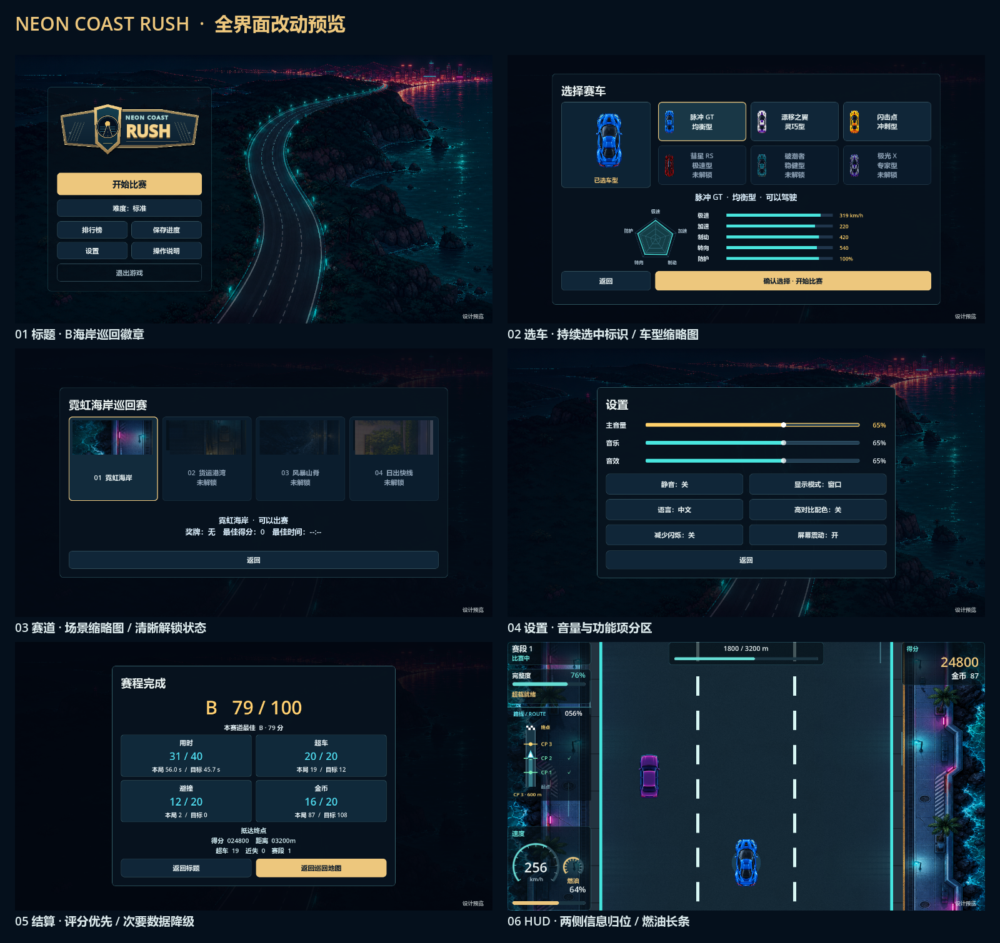

# 全界面方案预览

状态：设计提案，非正式版本。用户已选B海岸巡回徽章，本轮保留该方向。



- `title.png`：B徽章、主按钮优先、次操作双列；排行榜和保存入口均保留。
- `garage.png`：六车缩略图、持久选中样式、明确确认；性能数据沿用现有组件。
- `tour.png`：现有环境纹理的固定菜单缩略图，不修改游戏里的长背景。
- `settings.png`：音量行与功能项分区，不增加新的设置。
- `clear.png`：等级/评分为中心、四项明细、底部并列返回动作。
- `hud.png`：保留仪表、完整度/距离、小地图；补左下燃油长条，减少重复标签。
- `board.png`：真实排名字段分列展示；预览记录来自内存样例。

## 如何复现

在项目根目录使用本机Godot 4.7图形版本（不是headless）：

```text
Godot_v4.7-stable_win64.exe --path <项目根目录> --script res://docs/previews/ui-review-20261012/render.gd -- <尚不存在的输出目录>
Godot_v4.7-stable_win64.exe --path <项目根目录> --script res://docs/previews/ui-review-20261012/gallery.gd -- <输出目录> <尚不存在的总览PNG>
```

使用已有引擎，不安装工具。输出28张中英720p/1080p图，再排成总览。
原始对象为当前工作区Main，持久化由MemoryStore接管；不会加载或写入玩家存档。
成绩、车辆与赛道锁定状态为样例，不能当作真实进度。

这些文件只用于计划和预览，不得直接接入运行场景或作为整套正式UI代码复制。
焦点邻接、所有车型/锁定组合、动画、错误状态以及新HUD告警样式待后续实现验证。

使用技能：`game-ui-ux`负责布局/焦点/流程审查，`godot-ui`负责Control/主题/原生渲染。
未安装Taste Skill，未使用Computer Use或网页监督，未创建新的美术素材。
